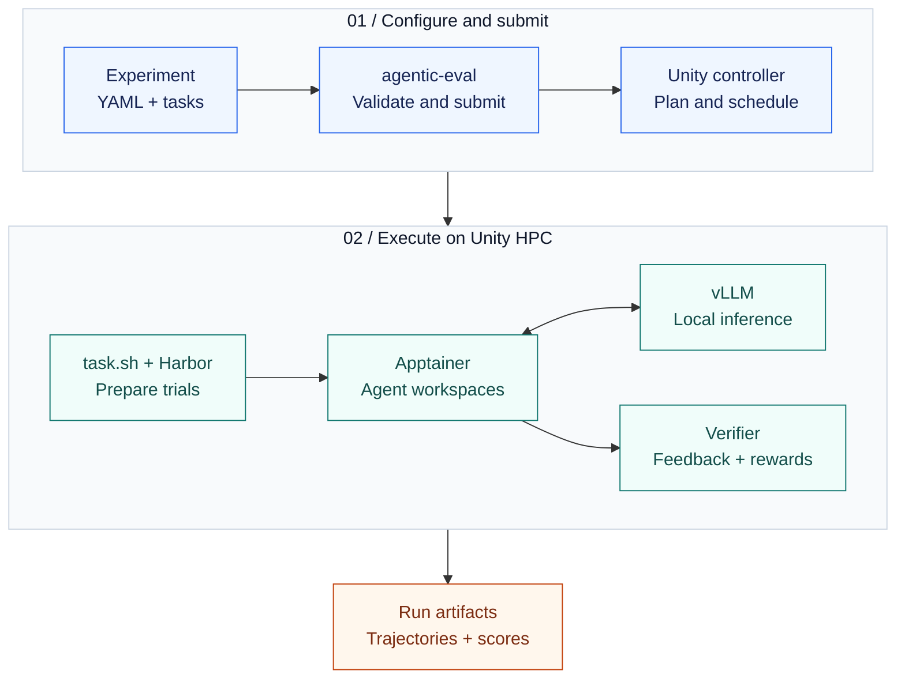
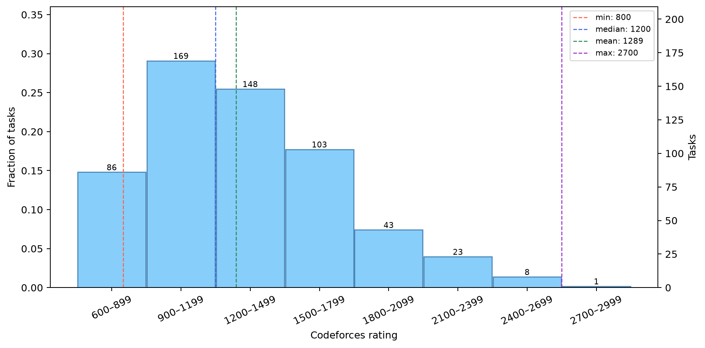

# Agent Eval HPC

**Configure agent experiments. Run them on Unity HPC. Inspect every trial.**

[](https://github.com/alirafiqmalik/agent-eval-hpc/actions/workflows/checks.yml)
[](pyproject.toml)
[](pyproject.toml)

A modular evaluation framework built on **Harbor**, with **Apptainer sandboxes**, **local model serving**, and a **Unity HPC runner**. Experiment folders bring together datasets, agent settings, prompts, resource requests, and scoring tools. Harbor supplies the job and task formats; this repository connects them to cluster execution and inspectable results.

[Quick start](#quick-start) · [Architecture](#architecture) · [Experiments](#experiments) · [Run on Unity](#run-on-unity) · [Results](#results-and-traceability) · [Extend](#add-an-experiment)

## What is implemented

| Capability | Implementation |
| --- | --- |
| **Experiments as configuration** | Harbor job YAML plus per-experiment agent, sandbox, and runner files; [validation](src/agentic_eval/jobs.py) checks the job schema and task layout. |
| **One execution interface** | The [CLI](src/agentic_eval/cli.py) supports local execution and cluster planning, submission, status, cancellation, and artifact retrieval. |
| **Shared inference, isolated trials** | The [allocation script](src/runners/unityhpc/jobs/task.sh) builds or reuses a sandbox image, starts the model server, and launches Harbor. |
| **Accountable cluster runs** | The [runner](src/runners/unityhpc/adapter.py) handles execution identities, resource budgets, source attestation, and downloaded artifact receipts. |
| **Inspectable evaluation** | Experiment tools export trajectories and score summaries; the [collector](scripts/unity_eval.py) checks completion and hardware receipts. |
| **Long-running research campaigns** | Verus SpecGym includes [smoke and control audits](experiments/verus_specgym_reproduce/tools/audit.py), [sharded campaigns](experiments/verus_specgym_reproduce/tools/campaign.py), and [completed-trial checkpoints](experiments/verus_specgym_reproduce/checkpointed.yaml). |

## Architecture



The diagram follows the default cluster path in [`unity.py`](src/agentic_eval/unity.py), [`adapter.py`](src/runners/unityhpc/adapter.py), [`task.sh`](src/runners/unityhpc/jobs/task.sh), and [`launch.py`](src/agentic_eval/launch.py). Local `agentic-eval run` invokes Harbor directly. Selected Verus profiles also support a separate model-serving allocation.

## Quick start

Use a Linux development environment with Git, Make, and either uv 0.11.2 or Python 3 with venv support. Run these commands from the repository root:

```bash
git clone https://github.com/alirafiqmalik/agent-eval-hpc.git
cd agent-eval-hpc

make setup
source .venv/bin/activate
make check
make validate
```

[`make setup`](scripts/setup.sh) installs Python 3.12 and the locked development dependencies, including Harbor. It can bootstrap uv into `.cache/setup-tools/`. The checks and validation above run locally without allocating cluster resources. Executing an experiment additionally requires its sandbox and model runtime.

Validate the second experiment or inspect the CLI:

```bash
make validate EXPERIMENT=experiments/verus_specgym_reproduce/job.yaml
agentic-eval --help
```

## Experiments

| Experiment | Included tasks | Agent and evaluation |
| --- | ---: | --- |
| [HumanEval starter](experiments/unityhpc-starter-experiment) | **164** Python tasks | Qwen Coder with Qwen3.5-9B; hidden-test grading, a two-task smoke job, and per-trial trajectories. |
| [Verus SpecGym](experiments/verus_specgym_reproduce) | **581** specification tasks | SWE-agent with local inference; syntax checks, precondition/postcondition soundness and completeness, verifier controls, and campaign analysis. |

Task counts come from the committed [HumanEval task folders](experiments/unityhpc-starter-experiment/tasks/humaneval) and [Verus manifest](experiments/verus_specgym_reproduce/tasks/manifest.json). Verus model suites, upstream revisions, execution limits, and reproduction deviations are recorded in [`reproduction.yaml`](experiments/verus_specgym_reproduce/reproduction.yaml).

### A view into the included dataset



This is **dataset composition**, not model performance. The image is generated by [`dataset_figures()`](experiments/verus_specgym_reproduce/tools/eval/plots.py) from the committed task metadata. To regenerate the analysis without running a model, use uv on your PATH, or `.cache/setup-tools/bin/uv` if setup bootstrapped it:

```bash
uv run --locked --group plots python \
  experiments/verus_specgym_reproduce/tools/eval/plots.py \
  experiments/verus_specgym_reproduce/output/dataset-preview --dataset-only
```

The image is written to `output/dataset-preview/results/figure-10-ratings.png` within the Verus experiment. Model comparison plots require complete scored campaign artifacts; this README does not report benchmark scores.

## Configuration at a glance

A complete, small job from the starter's [`smoke.yaml`](experiments/unityhpc-starter-experiment/smoke.yaml):

```yaml
job_name: unityhpc-starter-smoke
n_attempts: 1
n_concurrent_trials: 1
environment:
  type: singularity
agents:
  - name: qwen-coder
    model_name: Qwen/Qwen3.5-9B
datasets:
  - path: experiments/unityhpc-starter-experiment/tasks/humaneval
    task_names: [HumanEval_0, HumanEval_1]
```

| Change | Edit |
| --- | --- |
| Dataset, selected tasks, attempts, trial concurrency | `experiments/<name>/job.yaml` |
| Model and agent settings | `experiments/<name>/agent/agent-config.yaml` and the job's agent entry |
| Instructions and skills | `experiments/<name>/agent/prompts/system.md` and `agent/skills/` |
| GPU/CPU request, memory, wall time, serving command | `experiments/<name>/runner.yaml` |
| Sandbox dependencies | `experiments/<name>/sandbox/sandbox.def` |
| Controller address, partitions, retries, runtime path | `src/runners/unityhpc/connections/<profile>.yaml` |
| Grading and result processing | `experiments/<name>/tools/` |

## Run on Unity

Cluster execution requires a reachable **Unity HPC controller**, an account with access to the selected partitions, and a prepared cluster runtime with Harbor, the model-serving dependencies, and Apptainer/Singularity. Local setup does not install that cluster runtime.

Start from the [connection configuration](src/runners/unityhpc/connections/config.yaml), which contains a deployment-specific runtime path. Set your controller endpoint and absolute runtime directory, or use a local connection file such as `connections/my-local.yaml` (ignored by Git):

```bash
export UNITYHPC_CONTROLLER_URL="http://127.0.0.1:8301"
export UNITYHPC_RUNTIME_ROOT="/absolute/path/to/your/prepared/runtime"
```

Use the Unity controller's current inventory and telemetry to select available resources, then align the experiment's `runner.yaml` with your connection profile. Committed hardware profiles describe particular deployments; inspect them before submitting.

Plan a two-task smoke job, then submit and collect it:

```bash
agentic-eval plan experiments/unityhpc-starter-experiment/smoke.yaml \
  --run-id starter-smoke-001 \
  --runner-config src/runners/unityhpc/connections/config.yaml

make evaluate \
  EXPERIMENT=experiments/unityhpc-starter-experiment/smoke.yaml \
  RUN_ID=starter-smoke-001 \
  RUNNER_CONFIG=src/runners/unityhpc/connections/config.yaml
```

`plan` contacts the controller for a plan. `evaluate` submits, waits, fetches artifacts, and verifies completion. Use a new `RUN_ID` for each new submission.

| Operation | Command |
| --- | --- |
| Submit without waiting | `make submit RUN_ID=<id> EXPERIMENT=<job.yaml>` |
| Inspect cluster state | `make status RUN_ID=<id>` |
| Fetch artifacts | `make fetch RUN_ID=<id> EXPERIMENT=<job.yaml>` |
| Resume collection after an interruption | `make collect RUN_ID=<id> EXPERIMENT=<job.yaml>` |
| Cancel a run | `agentic-eval cancel --run-id <id> --runner-config <connection.yaml>` |

Pass the same `RUNNER_CONFIG=<connection.yaml>` to each Make command when using a custom connection. For local execution, `make run RUN_ID=<id> EXPERIMENT=<job.yaml>` uses Harbor on the current machine and requires a usable sandbox image and model endpoint. The CLI also accepts `run --base-url`.

## Results and traceability

```text
experiments/<name>/output/<run-id>/
├── logs/                         Harbor jobs and per-trial artifacts
│   └── trajectory.jsonl          Combined agent trace
└── results/
    ├── summary.json              Scores, trial counts, completion, errors
    ├── runtime.json              Package versions, model ID, agent version
    └── evaluation-manifest.json  Collection status and artifact receipts
```

[`post_run()`](src/agentic_eval/launch.py) invokes each experiment's trajectory exporter and summarizer. The cluster script records runtime versions; `make evaluate` and `make collect` write the evaluation manifest. The manifest ties collection to source and request digests, Slurm job IDs, hardware verification, and downloaded artifacts.

Check `complete`, `expected_total`, and `errors` before interpreting scores. The Verus [summarizer](experiments/verus_specgym_reproduce/tools/eval/summarize.py) retains infrastructure failures and missing evaluator evidence; its [plotting pipeline](experiments/verus_specgym_reproduce/tools/eval/plots.py) requires one scored attempt for each of the 581 tasks per model. Completed-trial checkpoints preserve finished work across allocations; they do not resume an unfinished agent conversation.

Run outputs, built `.sif` images, and local caches are [excluded from Git](.gitignore). Dataset files and experiment configurations are versioned; evaluation artifacts are collected separately.

## Add an experiment

Copy the starter into `experiments/<name>/`, update its job name and task paths, and configure the agent, sandbox, runner, and grading tools. Update sandbox image paths in the copied `task.toml` files and the generator's `IMAGE` constant to point to the new experiment. Keep Harbor's existing job and task formats. A new experiment lives in its own folder; shared orchestration stays in `src/`.

```text
experiments/<name>/
├── job.yaml                      Harbor job and dataset selection
├── runner.yaml                   Resource request and model server
├── agent/
│   ├── agent-config.yaml
│   ├── prompts/system.md
│   └── skills/
├── sandbox/sandbox.def           Versioned Apptainer recipe
├── tasks/<benchmark>/<task>/
│   ├── instruction.md
│   ├── task.toml
│   ├── environment/
│   ├── tests/
│   └── solution/solve.sh
└── tools/
    ├── verifier/                 Templates copied into generated tasks
    ├── trajectory/export.py
    └── eval/summarize.py
```

Use the [HumanEval generator](experiments/unityhpc-starter-experiment/tasks/generate.py) or [Verus importer](experiments/verus_specgym_reproduce/tasks/generate.py) as concrete examples. If you change a verifier template, regenerate the corresponding tasks. Finish with:

```bash
make check
make validate EXPERIMENT=experiments/<name>/job.yaml
```

## Development and provenance

[`make check`](Makefile) runs pytest, Ruff linting, and formatting checks. [GitHub Actions](.github/workflows/checks.yml) runs the same checks plus starter validation. The [tests](tests) cover job validation, runner behavior, local serving, cleanup, collection, and Verus evaluation logic.

Built on [Harbor](https://github.com/laude-institute/harbor), with datasets from [HumanEval](https://github.com/openai/human-eval) and [Verus SpecGym](https://github.com/formal-verif-is-cool/verus-spec-gym). Dataset revisions and import logic are recorded in the linked generators and reproduction configuration. The Verus experiment includes an [upstream license](experiments/verus_specgym_reproduce/LICENSE); a repository-wide license has not been selected.

For questions or reproducible bug reports, use the [issue tracker](https://github.com/alirafiqmalik/agent-eval-hpc/issues) and include the experiment path, command, and relevant error output.
